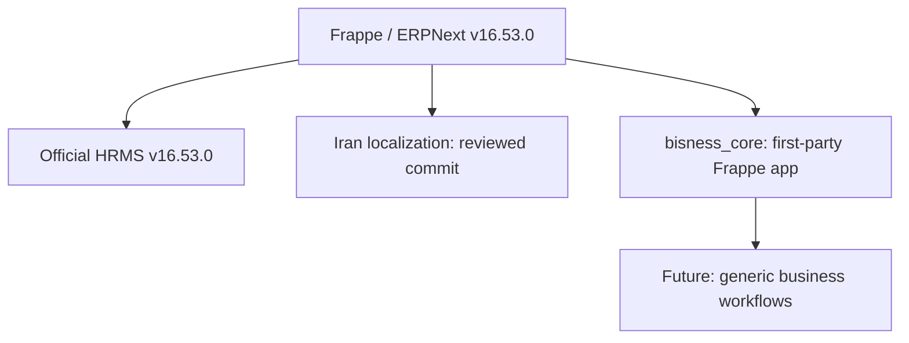

# Customer-independent ERPNext product baseline — design record (2026-11-04)

## Intent and boundaries

Build one reusable ERP product which can be configured and sold to multiple unrelated legal groups. The first delivery adds four app packages and removes fixed customer names from runtime deployment settings. It does **not** implement all requirements of any one RFP, install on a server, or migrate an existing site.

**Machine-readable component graph:** [product-components.json](./product-components.json). This is an explicitly maintained product inventory, not Graphify output or a claim of running services.

## Approaches and trade-offs

1. **Selected: versioned source + custom image + separate Frappe app.** Keeps upstream untouched and customer configuration separate. Requires controlled image builds and live integration tests.
2. Edit ERPNext upstream code directly. Rejected: creates upgrade conflicts and mixes product concerns with vendor code.
3. Encode one client's company setup into app fixtures. Rejected: prevents customer-independent sale and risks data leakage.

## Technical controls

- Base ERPNext image `v16.53.0`; HRMS release `v16.53.0` / commit `b12d935b99c1434618845fdd9f3a3d340b5a3aed`.
- Iranian app `bijanshdevops/erpnext_iran` commit `60dc7b8b51f42a74ba65bee314922326788db59b`, selected from a passing v16 integration CI. **Live tax authority testing was not evidenced**.
- Build fails if the third-party branch/tag has moved away from its approved commit. Registry digests must be pinned after successful acceptance tests.
- `bisness_core` is a skeleton: no seeded Company, no legal rates, no payroll automation and no financial posting hooks.
- Domain, image tag and private HTTP port are environment parameters. HTTPS is an explicit override, not automatic.
- A new-site script is opt-in and refuses to mutate an existing site.

## Acceptance gates before production

1. Static contract tests and Docker Compose config pass.
2. Image builds successfully, without moving unapproved external refs.
3. A disposable v16 site installs `erpnext`, `hrms`, `erpnext_iran`, `bisness_core` in order.
4. Accounting and HR pilot results are verified from actual GL, payroll and access-control evidence.
5. Iran-specific tax, insurance and Moadian are approved by qualified specialists and a controlled test.
6. Restore, upgrade/rollback, registry digest pinning, audit and licensing review pass.

## Commercial/legal open question

The product owner has not chosen a distribution license for `bisness_core`. Keep this first-party package private and unlicensed until legal review of ERPNext's GPL obligations and the desired commercial delivery model. Do not assume that selling the service requires an open-source or proprietary license for every component.

## Client RFPs

The existing customer-specific requirements and dependency graph remain in `docs/requirements/` and `docs/architecture/requirements-graph.*` for traceability. Their exact company names and IDs are **not** product defaults or feature tests.
