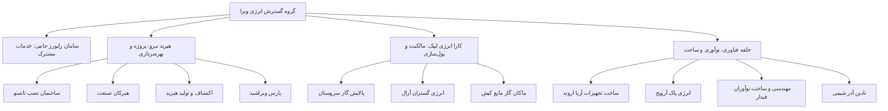
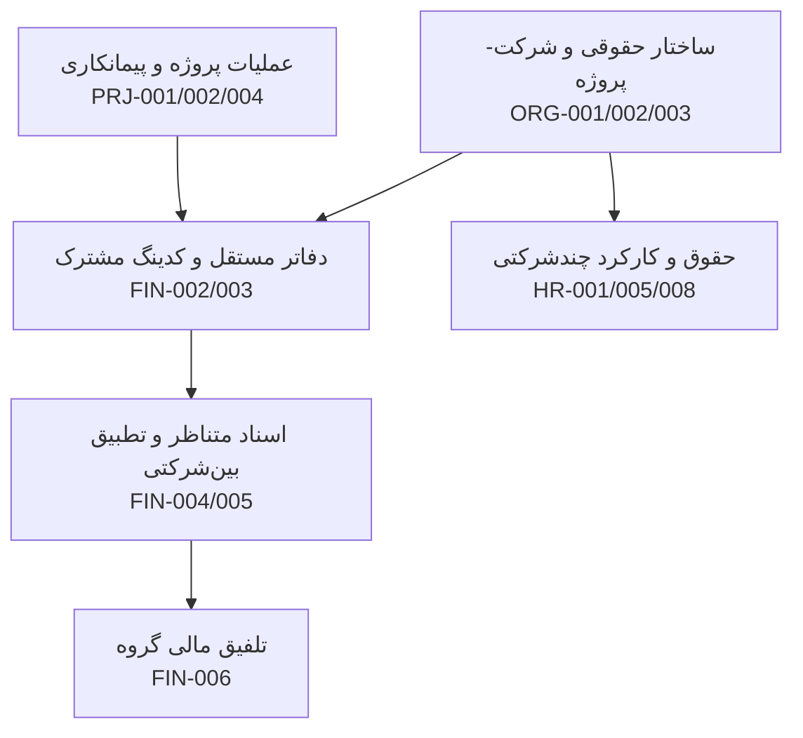
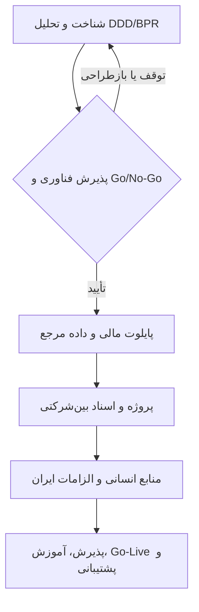

# گراف نیازمندی‌های ویرا

> **نوع:** گراف نیازمندی‌های تجاری در کنار Graphify. فایل ماشینی: [requirements-graph.json](./requirements-graph.json). مرجع شناسه‌ها: [requirements.yaml](../requirements/requirements.yaml).
>
> این فایل **خروجی Graphify نیست**. Graphify با `--code-only` اجرا می‌شود و مستندات PDF/Markdown را عمداً از گراف کد حذف می‌کند. نباید `graphify-out/graph.json` را دستی تغییر داد. زمانی که کد ERPNext و Graphify واقعاً بررسی شد، می‌توان هر شناسه `VIRA-...` را به نمادهای واقعی و تست‌هایش لینک کرد.

## ۱. ساختار سازمانی طبق نمودار PDF صفحه ۶

**هشدار:** این نمودار نمای مدیریتی RFP است، نه سند قطعی مالکیت قانونی. در تصویر شرکت‌های دیگری نیز وجود دارند که در جدول ۲۲۶ کاربر ذکر نشده‌اند؛ تعیین فهرست نهایی در شناخت انجام شود.

## ۲. گراف وابستگی قابلیت‌ها — پیشنهاد برای معماری، نه گزاره قراردادی

در این گراف، **ترتیب فازهای پس از شناخت پیشنهادی است**. کارفرما اولویت مالی، سپس پروژه-مالی و منابع انسانی و الزام اجرای مرحله‌ای را مشخص کرده، اما زمان و شرکت پایلوت را به پیشنهاد فنی پیمانکار واگذار کرده است.

## ۳. اتصال گراف کسب‌وکار به Graphify کد

| منبع | نقش | سیاست |
|---|---|---|
| `docs/requirements/requirements.yaml` | شناسه و منشأ ۵۹ نیازمندی | مرجع تجاری |
| `docs/architecture/requirements-graph.json` | تمام گره‌های نیازمندی، دسته‌ها و وابستگی‌های پیشنهادی | قابل خواندن ماشینی |
| `graphify-out/graph.json` | گراف خودکار کد/پیکربندی | فقط تولید ابزار؛ **دستی ویرایش نشود** |
| PR، تست، طراحی | ارتباط `VIRA-...` با نمادهای واقعی پس از راستی‌آزمایی | شواهد عملیاتی |

تا وقتی Graphify اجرا نشده یا سورس submodule ERPNext وارد دامنه نشده، **هیچ نماد ERPNext به‌عنوان پیاده‌سازی تأییدشده ثبت نمی‌شود**.
